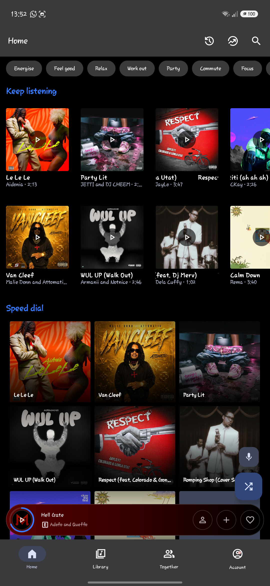
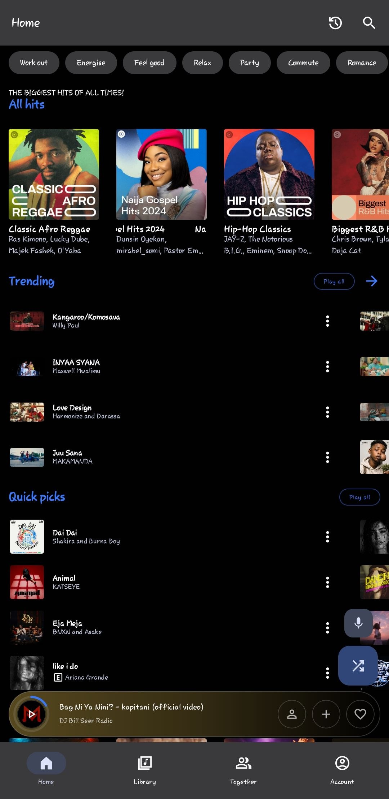
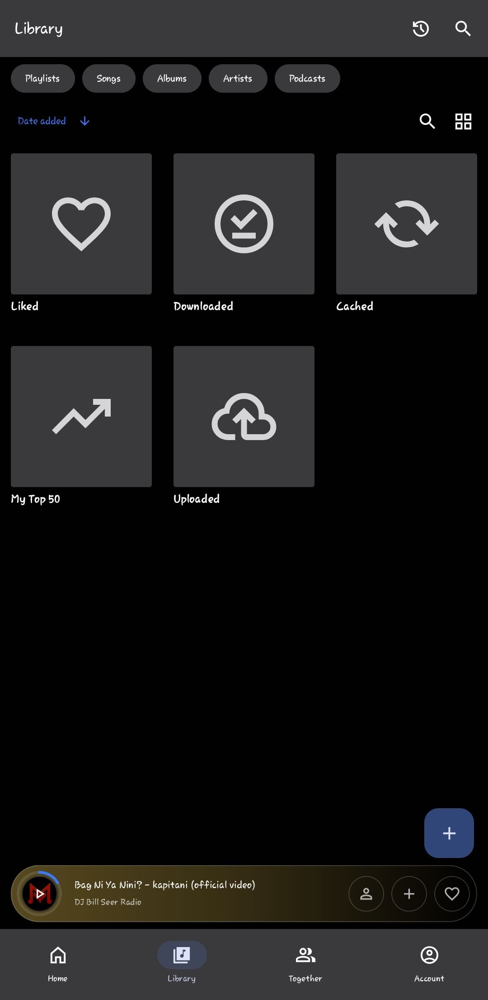
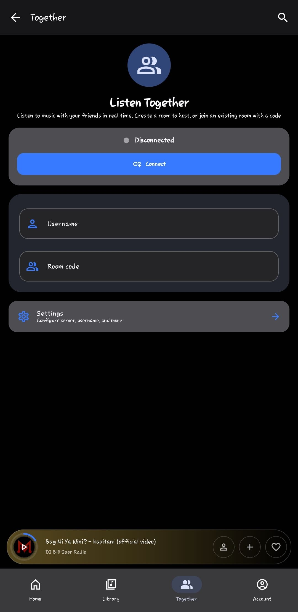
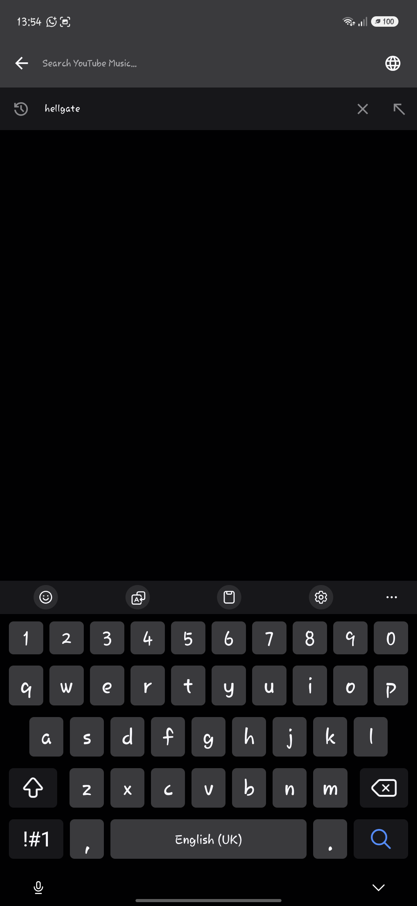
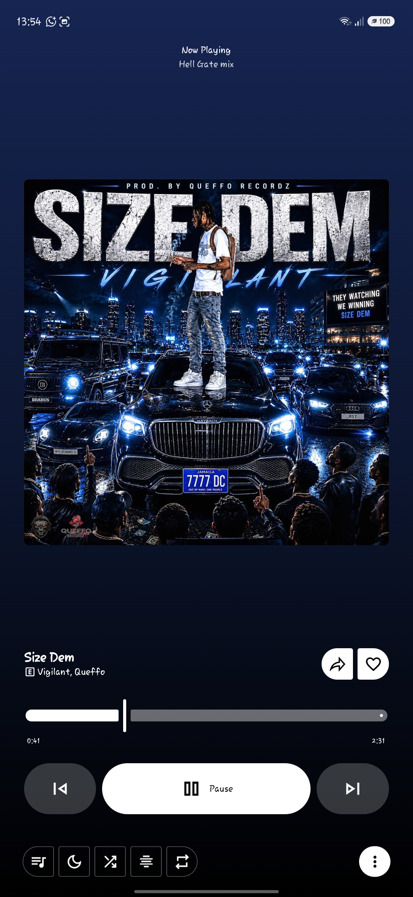

# Muzik

### Your entire YouTube Music library — beautifully reimagined for Android

**Live synced lyrics · Offline downloads · Listen Together · Built with Material 3**

 

 

[**Install Now**](#install-in-one-click) · [**Features**](#features) · [**Screenshots**](#screenshots) · [**Works Everywhere**](#works-everywhere) · [**FAQ**](#faq) · [**Translate**](#translations) · [**Support**](#support-the-project)

> [!IMPORTANT]
> **Sponsor the project** — Muzik is free, open source, and built with love. If it makes your day, [**buy us a soda**](https://buymesoda.com/lllcuDCr25N1a1peiKOCl22Oaf13). Every contribution keeps development alive.

> [!WARNING]
> **Regional Restriction** — If YouTube Music is unavailable in your region, this app will not work without a **VPN or proxy** connecting to a supported region.

---

<h1>Install in One Click</h1>

<h3>Every button below downloads the latest Muzik build directly — no redirects, no other pages. Open the downloaded file and the installer does the rest.</h3>

 

### Android · Windows · macOS · Linux — one glossy button each

<table>
  <tr>
    <td align="center" valign="bottom">
      
       
      Phones &amp; tablets — tap the button, the APK downloads, open it and tap Install. Done.
    </td>
    <td align="center" valign="bottom">
      
       
      Windows 10 / 11 — run the MSI, Muzik installs with Start-menu shortcuts and launches automatically.
    </td>
  </tr>
  <tr>
    <td align="center" valign="bottom">
      
       
      Apple Silicon (M1 – M4) — open the DMG and drag Muzik into Applications. Done.
    </td>
    <td align="center" valign="bottom">
      
       
      Debian / Ubuntu / Mint — double-click the DEB or <code>sudo apt install ./muzik-linux-amd64.deb</code>
    </td>
  </tr>
</table>

Every button points straight at the newest release asset — the download starts immediately, no redirects, no other pages.

### More direct downloads (no redirects)

| Platform | File | Direct link |
| --- | --- | :---: |
| Windows | Portable ZIP (no installer) | [Muzik-windows-x64.zip](https://github.com/MuzikGroup/Muzik/releases/latest/download/Muzik-windows-x64.zip) |
| Windows | In-app updater binary | [muzik-installer-windows-x64.exe](https://github.com/MuzikGroup/Muzik/releases/latest/download/muzik-installer-windows-x64.exe) |
| Linux | Fedora / openSUSE | [muzik-linux-x64.rpm](https://github.com/MuzikGroup/Muzik/releases/latest/download/muzik-linux-x64.rpm) |
| Any OS | Portable JAR (Java 21+) | [muzik-portable.jar](https://github.com/MuzikGroup/Muzik/releases/latest/download/muzik-portable.jar) |
| Android | Google Cast variant | [Muzik-with-Google-Cast.apk](https://github.com/MuzikGroup/Muzik/releases/latest/download/Muzik-with-Google-Cast.apk) |
| Android | IzzyOnDroid variant | [Muzik-izzy.apk](https://github.com/MuzikGroup/Muzik/releases/latest/download/Muzik-izzy.apk) |
| Any | Checksums | [SHA256SUMS](https://github.com/MuzikGroup/Muzik/releases/latest/download/SHA256SUMS) |

<b>F-Droid:</b> coming soon (build recipe in <code>.fdroid/fdroid.yml</code>)

Windows installers are Authenticode-signed when a signing certificate is configured in CI; until then SmartScreen may ask for <i>More info → Run anyway</i> on first run.

---

<h1>Works Everywhere</h1>

<h3>One universal APK, every device. Muzik ships all CPU architectures in a single install, so it runs smoothly wherever Android runs.</h3>

 

| Device | Supported |
| --- | :---: |
| Phones & tablets (ARM) | ✔ |
| Foldables & large screens | ✔ |
| ChromeOS laptops | ✔ |
| Android emulators (x86 / x86_64) | ✔ |
| Android TV (sideload) | ✔ |
| Dark, light, black & dynamic themes | ✔ |

**Minimum requirement:** Android 8.0 (API 26) — covering virtually every Android device in use today.

<h2>Desktop — built right here in this repo</h2>

Muzik now runs on your computer too. Same violet, same catalog, one suite — Android and desktop live together in this single repository and ship every release together:

| OS | Get it (direct download) |
| --- | :---: |
| **Windows 10/11** | [MSI installer](https://github.com/MuzikGroup/Muzik/releases/latest/download/Muzik-windows-x64.msi) · [Portable ZIP](https://github.com/MuzikGroup/Muzik/releases/latest/download/Muzik-windows-x64.zip) |
| **macOS** (Apple Silicon) | [DMG](https://github.com/MuzikGroup/Muzik/releases/latest/download/Muzik-macos-arm64.dmg) |
| **Linux** (Deb / RPM / portable JAR) | [DEB](https://github.com/MuzikGroup/Muzik/releases/latest/download/muzik-linux-amd64.deb) · [RPM](https://github.com/MuzikGroup/Muzik/releases/latest/download/muzik-linux-x64.rpm) · [JAR](https://github.com/MuzikGroup/Muzik/releases/latest/download/muzik-portable.jar) |

One-click install buttons with per-platform instructions live in the [**Install in One Click**](#install-in-one-click) section above.

The desktop sources live in the [`desktop/`](desktop) directory (Kotlin Multiplatform + Compose, modules `shared` and `desktopApp`).

---

<h1>Features</h1>

<table>
  <tr>
    <td width="50%" valign="top">

#### Playback
- Stream any song or video from YouTube Music
- Background playback
- Download & cache for offline use
- Skip silence
- Sleep timer

</td>
    <td width="50%" valign="top">

#### Audio
- Audio normalization
- Tempo & pitch control
- Equalizer

</td>
  </tr>
  <tr>
    <td width="50%" valign="top">

#### Lyrics & Discovery
- Live synced lyrics
- AI-powered lyrics translation
- Personalized quick picks
- Search songs, albums, artists, videos, and playlists

</td>
    <td width="50%" valign="top">

#### Library & Account
- Full library management
- Local playlists
- Import playlists
- Reorder songs in playlist or queue
- YouTube Music account login
- Sync songs, artists, albums, and playlists

</td>
  </tr>
  <tr>
    <td width="50%" valign="top">

#### Social
- Listen together with friends in real-time

</td>
    <td width="50%" valign="top">

#### Interface
- Home screen widget
- Light / Dark / Black / Dynamic theme modes
- Dynamic color + 19 preset color palettes
- Built with Material 3

</td>
  </tr>
</table>

 

<h2>Screenshots</h2>

  
  
  
  
  
  

---

<h1>FAQ</h1>

<h3>Questions, ideas, or need a hand? Join the conversation on our <a href="https://github.com/MuzikGroup/Muzik/discussions">GitHub Discussions</a> — the community and the developers are all there.</h3>

---

<h1>Translations</h1>

<h3>Muzik's strings are managed through Crowdin (see <code>crowdin.yml</code>). Want Muzik in your language? Open an issue or pull request and help make Muzik a little more accessible to someone, somewhere in the world.</h3>

---

<h1>Support the Project</h1>

<h3>Muzik is free to listen and share with friends — and it stays free because of people like you. Follow the lead developer, give the repo a star, and if you can, buy us a soda. It goes a long way.</h3>

 

  

**Direct link:** [buymesoda.com/lllcuDCr25N1a1peiKOCl22Oaf13](https://buymesoda.com/lllcuDCr25N1a1peiKOCl22Oaf13)

You can also click the pink **Sponsor** button at the top of this repository.

---

<h1>Team</h1>

<h3>Muzik is developed and maintained by</h3>

<h3><a href="https://github.com/Motius">Ignatius (motius)</a></h3>

<h3>in partnership with <a href="https://www.pipo-ke.com/">pipo.ai</a></h3>

---

<h1>Disclaimer</h1>

This project is **not affiliated with, funded, authorized, endorsed by, or in any way associated** with YouTube, Google LLC, or any of their affiliates and subsidiaries.

All trademarks, service marks, and intellectual property rights referenced in this project belong to their respective owners.

---

 

**Made with ❤️ by [Ignatius](https://github.com/Motius) & [pipo.ai](https://www.pipo-ke.com/)**

